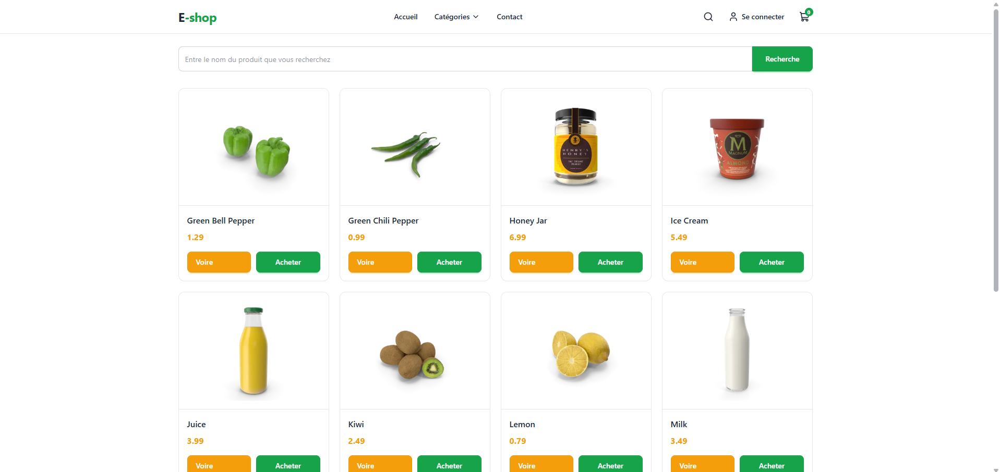

# 🛒 E-shop — Application Web E-Commerce Full-Stack (Mock API)

> Une application web e-commerce moderne, interactive et fortement typée, propulsée par React, TypeScript et Vite. Elle offre une expérience d'achat fluide incluant un catalogue paginé, une recherche dynamique, un panier intelligent et un système complet d'authentification.

---

## 📸 Aperçu du projet

<div align="center">
  <!-- Remplacez le lien ci-dessous par l'adresse de votre image d'aperçu une fois poussée sur GitHub (avec ?raw=true) -->
  
</div>

---

## 🚀 À propos du projet

**E-shop** a été conçu selon les standards modernes du développement frontend avec une gestion d'état serveur performante, un typage strict et un contrôle continu de la qualité du code. Les utilisateurs peuvent :

- 🔍 **Explorer le catalogue** : Parcourir les produits avec un système de recherche en temps réel et une pagination fluide.
- 🛍️ **Gérer le panier d'achat** : Ajouter, modifier les quantités ou supprimer des articles avec calcul automatique des sous-totaux et du montant total.
- 🔐 **S'authentifier** : Créer un compte utilisateur ou se connecter via des formulaires validés en temps réel.
- 🔔 **Recevoir des retours instantanés** : Notifications visuelles élégantes lors de chaque action (succès, erreurs ou confirmations).
- 🗄️ **Interagir avec une API REST** : Persistance, mise en cache et synchronisation des données via une API simulée.

---

## 🛠️ Stack Technique

<p align="left">
  <!-- Vite -->
  <a href="https://vitejs.dev/" target="_blank" rel="noreferrer">
    
  </a>
  &nbsp;&nbsp;
  <!-- React JS -->
  <a href="https://reactjs.org/" target="_blank" rel="noreferrer">
    
  </a>
  &nbsp;&nbsp;
  <!-- TypeScript -->
  <a href="https://www.typescriptlang.org/" target="_blank" rel="noreferrer">
    
  </a>
  &nbsp;&nbsp;
  <!-- Tailwind CSS -->
  <a href="https://tailwindcss.com/" target="_blank" rel="noreferrer">
    
  </a>
  &nbsp;&nbsp;
  <!-- DaisyUI -->
  <a href="https://daisyui.com/" target="_blank" rel="noreferrer">
    
  </a>
  &nbsp;&nbsp;
  <!-- Lucide React -->
  <a href="https://lucide.dev/" target="_blank" rel="noreferrer">
    
  </a>
  &nbsp;&nbsp;
  <!-- React Router -->
  <a href="https://reactrouter.com/" target="_blank" rel="noreferrer">
    
  </a>
  &nbsp;&nbsp;
  <!-- Node JS / JSON Server -->
  <a href="https://nodejs.org/" target="_blank" rel="noreferrer">
    
  </a>
  &nbsp;&nbsp;
  <!-- ESLint -->
  <a href="https://eslint.org/" target="_blank" rel="noreferrer">
    
  </a>
</p>

### Architecture & Outils :

- **Core, Build & Typage :** React.js, TypeScript et Vite pour une application rapide, structurée et sécurisée sur le plan des types.
- **UI, Design & Icônes :** Tailwind CSS et DaisyUI pour le design responsive, accompagnés de Lucide React pour les icônes.
- **Navigation & Formulaires :** React Router pour la navigation multi-pages (catalogue, panier, connexion, inscription) et React Hook Form pour la gestion et la validation des formulaires.
- **Data Fetching, Cache & API :** Axios pour les requêtes HTTP vers une API REST simulée avec JSON Server, couplé à TanStack Query pour la gestion du cache, des états de chargement, des erreurs et de la synchronisation des données.
- **UX & Qualité du code :** React Hot Toast pour les notifications utilisateur et ESLint pour maintenir un code propre et cohérent.

---

## ⚙️ Installation et Démarrage Rapide

Assurez-vous d'avoir **Node.js** et **Git** installés sur votre machine, puis copiez et exécutez la commande unique ci-dessous dans votre terminal pour cloner le projet, installer les dépendances et lancer le serveur de développement en une seule fois :

```bash
git clone [https://github.com/tchoupo237/E-shop.git](https://github.com/tchoupo237/E-shop.git) && cd E-shop && npm install && npm run dev
```
